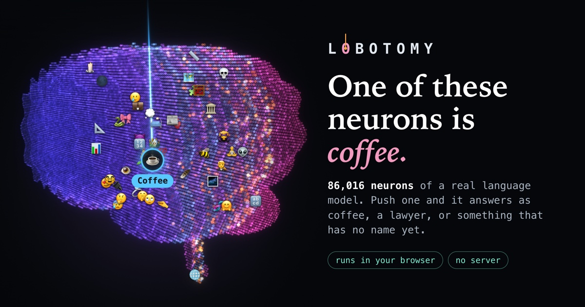

# LOBOTOMY — open-brain surgery on a language model, in your browser

**https://n7olkachev.github.io/lobotomy/**

Explore the 86,016 MLP neurons of Qwen3.5-0.8B while it runs on WebGPU in your browser: a 3D brain to poke on one
side, the patient to talk to on the other. Push one neuron and watch the personality change. No server: the model is
an ONNX export with one extra graph input (`steer[24, 3584]`) that adds a constant to any neuron's activation at
every token — the same intervention as the "Evil Qwen" recipes (Lyra, Oct 2026), compiled into the graph
(`scripts/steer/surgery.py`, see "Where the model comes from").

## Dev

    npm install && npm run dev          # http://localhost:5173

The model is loaded the way the site loads it (see "Where the model comes from"): 470 MB from Hugging Face, once.

To work on a new export, serve a whole model directory and name it in `.env.development.local`: `VITE_MODEL_BASE`
(a path on the dev server or a URL) and `VITE_MODEL_ID` (the directory, default `q35-0.8b-text`). Hugging Face is
then not asked for anything.

    # model files (470 MB q4f16 + stats) are served from ~/ai/neuron-onnx/models via ~/ai/neuron-onnx/js/serve.mjs on :8765
    (cd ~/ai/neuron-onnx/js && node serve.mjs &)
    echo VITE_MODEL_BASE=/models/ > .env.development.local      # /models is proxied to :8765

Every push to `main` is built and published to GitHub Pages by `.github/workflows/pages.yml`.

## The game

Two halves: the brain on the left (on top, on a phone), the patient on the right.

**The brain** is drawn in 3D: 24 slices from front to back, one per layer of the model, each holding that layer's
3,584 neurons on a honeycomb. Drag turns it, the wheel or a pinch zooms. The rail under it (or ← →) cuts the brain
open at a layer: the slices in front of the cut come off, the open slice is at full brightness and its neurons can
be picked one by one. Emoji mark the neurons that have names.

- **Tap a neuron** and an electrode goes in: the neuron is pushed (dose 1, up or down, at every token) and the
  patient is asked the same question again. The card under the brain shows the neuron, its two faces (what the
  scanner read off each: *I am a ___*), the strength, and the other electrodes that are in.
- **Scan.** The scanner pushes one neuron during a single prefill of `"Who are you?"` + `"I am a"` and reads the next
  word. That is the screen that found the catalogued neurons (`mlx_screen.py`), run live in the worker at about
  100 ms per push. A neuron nobody has read is scanned when it is tapped; "scan this layer" reads a whole layer in
  the background (about 12 minutes). What was read colours the neuron: quiet, a hint, a signal.
- **Name.** A neuron nobody has named can be named; names, scans and "heard" notes live in localStorage.
  A link carries the name (`?r=L3N358+1&name=…`).

**The patient** is a conversation. Every answer is one turn: the question, the brain as it was, the answer, and under
it the untouched model's answer to the same question, the vitals and the buttons (share image, the same question at
six strengths, link). A line across the conversation says what was done to the brain between two answers. Each
question is asked fresh: the patient does not remember the one before, so two answers differ only by the electrodes.

Before the model is loaded (470 MB, cached after the first time) the page plays recordings of the named neurons.
`?asleep` in the address keeps the model from loading by itself, to see the page as a first-time visitor does.

**On a phone** the brain is on top and gets most of the window; under it are the card of the neuron that is pushed
and a short conversation that opens at the answer. The strip with the monitor is the handle between the two: a tap (or
a swipe) on it pulls the conversation up over the brain to read, a tap on the brain puts it back. With the keyboard up
the brain makes way for the conversation and the box.

**Where the conversation scrolls to** (`useFollow` in `src/chat.tsx`): a new exchange is always brought into view.
While it fits into the window it is shown whole; once it is taller it stays at its beginning while the rest is typed
below the edge: at the question, or at the answer when the window is too small for both (a phone). A reader who
scrolls is left alone, one who scrolls to the end is kept at the end, and the next exchange starts over.

`public/survey/` holds layers that were scanned in advance with the browser model (`index.json` + `L{n}.json`:
word, confidence and KL per face). They show up as charted slices; the rest of the brain is uncharted (and dim).
To add one: cut the brain open at the layer, "scan this layer", then ⚙ → "export the scan of layer N", put the
file in `public/survey/` and add the layer to `index.json`.

## Layout

- `src/worker.ts` — transformers.js in a Web Worker: where the model's files come from (and what the visitor is told
  when Hugging Face cannot be reached), load on WebGPU, session patch that injects `steer`, streaming
  generation, coherence scoring (perplexity of the answer under the unsteered model = one extra prefill). A run is a list
  of variants (steered, untouched, or the six rungs of a dose ladder). Decoding is greedy, so answers are cached per
  (prompt, recipe), and a generation that gets stuck in a loop is cut short. `scan` reads faces one prefill at a time.
- `src/weights.ts` — the 470 MB of weights: downloaded straight to disk (the origin's private file system) and handed
  to the runtime a tensor at a time, so that they are never all in memory at once (a phone has no room for that).
- `src/steer.ts` — recipe strings (`L14N8949+1 L13N7956-1`), dose normalisation
  (`steer[L,n] = dose · median‖h_L‖ / ‖W_down[:,n]‖`), stats loading.
- `src/store.ts` — the map: readings per face (survey files + the player's scans), what counts as a signal,
  persistence.
- `src/geo.ts` — where every neuron sits: an implicit brain (cerebrum with its fissure, temporal lobes, cerebellum,
  stem) cut into 24 slices; each slice gets exactly 3,584 cells of a honeycomb, its plate of glass and its rim.
- `src/gl.ts` — the renderer (WebGL2, no library): slices drawn back to front as a plate that dims what is behind it
  plus 3,584 points of light, a glow pass, the camera, the cut, the waves that run through the layers with every
  token, the ring an electrode sends out, finding the neuron under a finger, a still for the share image.
  Drawn at half the frame rate while the model is answering: they share the GPU.
- `src/brainview.tsx` — the canvas in the page: colours from the map, the labels that float on it, the gestures.
- `src/parts.tsx` — the card of the neuron under the probe (faces, strength, other electrodes), the layer rail,
  the atlas of named neurons, the list of signals of a layer.
- `src/chat.tsx` — the patient: monitor, the conversation (turns, dose ladders, recordings, the introduction),
  where it is scrolled to, the box to ask in.
- `src/app.tsx` — state and wiring: worker messages, the scan queue (runs whenever the patient is not answering; a
  question interrupts it), a run on every electrode change, URL (`?r=recipe&q=question&name=…`), auto-play of
  recordings before the model is loaded, auto-load when the model is cached.
- `src/card.ts`, `src/ink.ts` — the shareable PNGs (case file with a photo of the brain as it is on screen, dose
  ladder), drawn on a canvas.
- `src/text.ts`, `src/md.tsx`, `src/vitals.ts`, `src/personas.ts` — loop detection and pull quotes, markdown rendering
  of model output, the vitals (state + symptoms), emoji and naming for catalog entries.
- `public/catalog.json` — the neurons that already have names (from the sweep: `mlx_screen.py`, `mlx_rollout.py`).
  An optional `"emoji"` field overrides the emoji table in `src/personas.ts`.

## Where the model comes from

The weights, the tokenizer and the config are the stock export
[`onnx-community/Qwen3.5-0.8B-Text-ONNX`](https://huggingface.co/onnx-community/Qwen3.5-0.8B-Text-ONNX) (of
`Qwen/Qwen3.5-0.8B`, Apache-2.0). The browser downloads them from Hugging Face, at a pinned revision, and keeps them:
later visits ask Hugging Face for nothing. Three small files are ours and ship with the site, in `public/steer/`:

    model_steer_q4f16.onnx       # their graph model_q4f16.onnx with the `steer` input added (surgery.py); reads their weights file
    stats.json  down_norms.bin   # dose normalisation (from calib.py)

The scripts that make them are in `scripts/steer/`, and they give these files back byte for byte. `surgery.py` needs
`onnx` and `numpy`; `calib.py` runs the PyTorch model once (`torch`, `transformers`) and reads it from
`scripts/steer/models/q35-0.8b-text/`, a download of the export above:

    cd scripts/steer/models/q35-0.8b-text/onnx
    python ../../../surgery.py model_q4f16.onnx model_steer_q4f16.onnx --data-name model_steer_q4f16.onnx_data
    cd ../../.. && python calib.py      # stats/stats.json, stats/down_norms.bin

`common.py` also holds the same intervention as a PyTorch hook (`TorchSteerer`), the reference the graph was checked against.

`src/worker.ts` shows the library one model directory made of the two. Hugging Face cannot be reached from
everywhere (mainland China blocks it): the page says so when the download fails.

The runtime's wasm also ships with the site, in `public/ort/<version>/`, and not from jsDelivr as the library would
have it. It is the published `ort-wasm-simd-threaded.asyncify.wasm` of that version of onnxruntime-web with its
mid-size functions padded, so that Safari's optimizing compiler leaves them alone: compiling them is what made an
iPhone kill the tab once the model began to answer ([WebKit bug 304810](https://bugs.webkit.org/show_bug.cgi?id=304810)).
`scripts/pad-ort-wasm.py` makes it, and has to be run again when `@huggingface/transformers` brings a new
onnxruntime-web: until then the worker sees that the versions differ and loads the stock file.

A directory named with `VITE_MODEL_BASE` holds everything:

    config.json  tokenizer.json  tokenizer_config.json  generation_config.json
    stats.json  down_norms.bin                     # dose normalisation (from calib.py)
    onnx/model_steer_q4f16.onnx  onnx/model_steer_q4f16.onnx_data   # surgery.py output (+ hard link / copy of the data)
